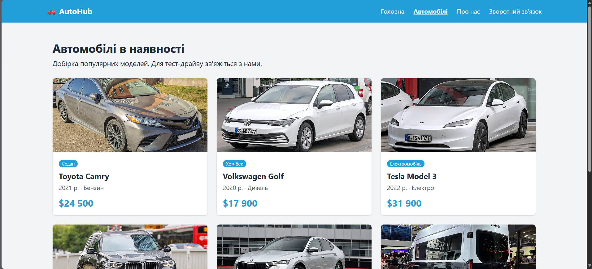

# Звіт до лабораторної роботи 03
## Розробка базового вебпроєкту

**ПІБ:** Данильчук Олександр (дописати по батькові)  
**Група:** ІПЗ-21  
**Склад команди:** Наконечний Михайло, Данильчук Олександр, Бондар Роман  
**Тема (предметна область):** AutoHub — автосалон (купівля автомобілів)  
**Репозиторій:** https://github.com/misha808/lab03-autohub

## Особистий внесок

- Розробив сторінку «Автомобілі» для вебпроєкту AutoHub.
- Оновив файл `data.py`, додав інформацію про 6 автомобілів: Toyota Camry, Volkswagen Golf, Tesla Model 3, BMW X5, Skoda Octavia та Ford Transit.
- Додав фотографії автомобілів, роки випуску, типи пального та ціни.
- Оновив шаблон `templates/shop.html`, реалізував відображення автомобілів у вигляді карток.
- Перевірив роботу сторінки в браузері на локальному сервері Flask.
- Створив окрему гілку `feature/shop`, виконав коміт і відправив зміни на GitHub.
- Створив Pull Request, після чого зміни були об'єднані з основною гілкою `main`.

**Мій коміт:**

- [feat: add shop page](https://github.com/misha808/lab03-autohub/commit/3f37676)

**Мій Pull Request:**

- [Додавання сторінки автомобілів — PR #1](https://github.com/misha808/lab03-autohub/pull/1)

## Скріншоти

Сторінка сайту у звичайному (десктопному) вигляді.

**Автомобілі**

На сторінці представлено 6 автомобілів із фотографіями, характеристиками та цінами.

## Труднощі та їх вирішення

- **Налаштування Git та GitHub.** Під час роботи виникали труднощі з авторизацією GitHub. Після повторної перевірки команди `git push` зміни були успішно завантажені.
- **Встановлення залежностей Python.** Під час першого запуску проєкту виникла помилка `ModuleNotFoundError: No module named 'flask'`. Проблему було вирішено встановленням необхідних бібліотек.
- **Робота з гілками Git.** Для уникнення конфліктів зміни вносилися в окремій гілці `feature/shop`, після чого були об'єднані з `main` через Pull Request.

## Висновки

У ході виконання лабораторної роботи я взяв участь у командній розробці вебпроєкту AutoHub на Python із використанням Flask. Мною було реалізовано сторінку каталогу автомобілів із фотографіями, характеристиками та цінами. Я навчився працювати з окремими гілками Git, створювати коміти, завантажувати зміни на GitHub та використовувати Pull Request для об'єднання роботи учасників команди. Отримані навички допоможуть у подальшій командній розробці програмних проєктів.